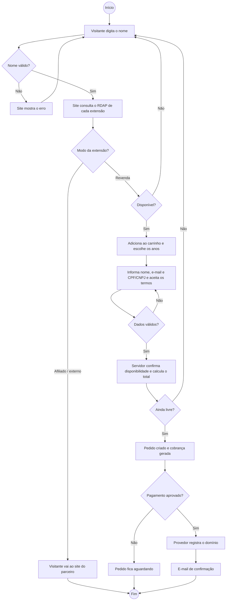
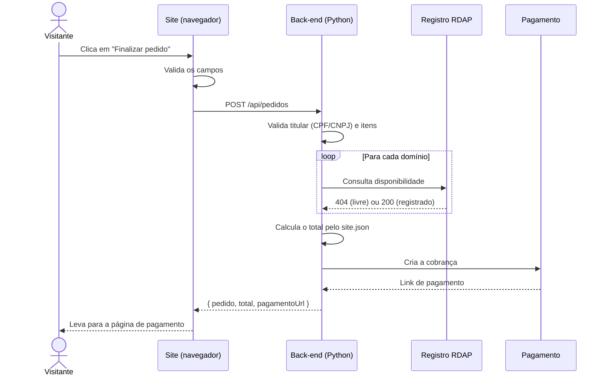

# Requisitos e modelagem do site de domínios

Documento de análise do sistema, seguindo o que foi visto em Engenharia de Requisitos
(requisitos funcionais, não funcionais, regras de negócio e diagramas UML).

## 1. Visão geral

Site que vende domínios de dois jeitos:

- **Revenda:** o visitante compra aqui. O registro é feito por um provedor credenciado (via API).
- **Afiliado / externo:** o visitante é levado ao site de um parceiro, e o site pode ganhar comissão.

## 2. Atores

| Ator | Descrição |
|---|---|
| Visitante | Pesquisa domínios, monta o carrinho, compra ou segue para o parceiro |
| Administrador | Configura preços, extensões, links de afiliado e acompanha pedidos |
| Provedor de domínios | Sistema externo que registra o domínio (API) |
| Serviço de pagamento | Sistema externo que cobra o visitante |
| Registro RDAP | Sistema externo consultado para saber se o domínio está livre |

## 3. Requisitos funcionais (RF)

| Código | Requisito |
|---|---|
| RF01 | Pesquisar um nome e mostrar a situação em cada extensão (disponível, registrado ou a conferir) |
| RF02 | Mostrar as extensões com preço de registro e de renovação (revenda) ou o nome do parceiro |
| RF03 | Adicionar e remover domínios do carrinho |
| RF04 | Escolher o período de registro (1 a 5 anos) |
| RF05 | Coletar os dados do titular (nome, e-mail, CPF/CNPJ) e o aceite dos termos |
| RF06 | Criar o pedido e gerar a cobrança |
| RF07 | Registrar o domínio no provedor depois do pagamento confirmado |
| RF08 | Levar o visitante ao parceiro com o link de afiliado |
| RF09 | Receber mensagens pelo formulário de contato |
| RF10 | Mostrar e guardar a escolha de cookies do visitante |

## 4. Requisitos não funcionais (RNF)

| Código | Requisito |
|---|---|
| RNF01 | Acessibilidade: navegação por teclado, textos alternativos, contraste mínimo 4,5:1 (WCAG AA) |
| RNF02 | Responsivo: funcionar bem em celular, tablet e computador |
| RNF03 | Privacidade: seguir a LGPD, sem rastreamento antes do consentimento |
| RNF04 | Segurança: chaves de API só no servidor (arquivo `.env`), nunca no navegador |
| RNF05 | Manutenção: nome, logo, preços e links ficam em um único arquivo (`dados/site.json`) |
| RNF06 | Desempenho: sem fontes ou bibliotecas externas no front-end |

## 5. Regras de negócio (RN)

| Código | Regra |
|---|---|
| RN01 | O preço é sempre recalculado no servidor; o valor do navegador é só informativo |
| RN02 | Total do item = preço de registro + preço de renovação × (anos − 1) |
| RN03 | Domínios `.br` têm entre 2 e 26 caracteres e exigem CPF ou CNPJ |
| RN04 | A disponibilidade é confirmada de novo ao criar o pedido |
| RN05 | O registro só acontece depois do pagamento aprovado |
| RN06 | Extensões fora do modo "revenda" não podem entrar no carrinho |
| RN07 | Links de afiliado são identificados para o visitante |

## 6. Casos de uso

```
Visitante ──── (Pesquisar domínio)
          ├─── (Gerenciar carrinho)
          ├─── (Finalizar pedido) ──«include»──> (Informar dados do titular)
          │                       └─«include»──> (Confirmar disponibilidade) ─── Registro RDAP
          ├─── (Ir para parceiro)
          ├─── (Enviar contato)
          └─── (Escolher cookies)

Serviço de pagamento ──── (Confirmar pagamento) ──«include»──> (Registrar domínio) ─── Provedor
Administrador ──── (Configurar extensões e preços)
```

## 7. Diagrama de atividades: comprar um domínio



## 8. Diagrama de sequência: finalizar pedido



## 9. Classes principais (back-end)

| Módulo | Responsabilidade |
|---|---|
| `servidor.py` | Recebe as requisições e escolhe a rota |
| `pedidos.py` | Valida e cria pedidos; guarda contatos |
| `validacao.py` | CPF, CNPJ, e-mail e nome de domínio |
| `disponibilidade.py` | Consulta ao RDAP |
| `provedor.py` | Integração com a API do provedor de revenda |
| `pagamento.py` | Integração com o serviço de pagamento |
| `configuracao.py` | Lê o `site.json` e o `.env` |
